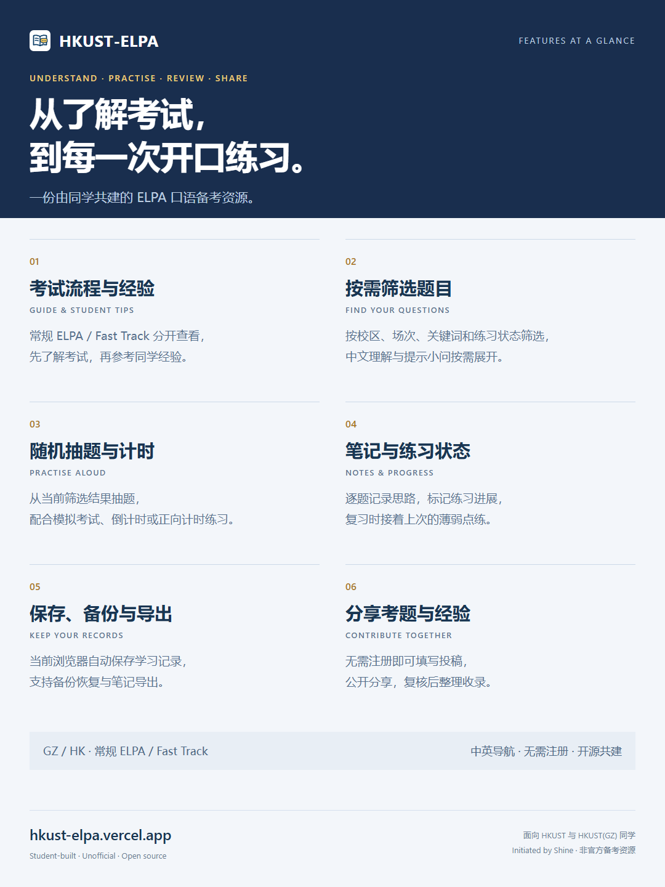
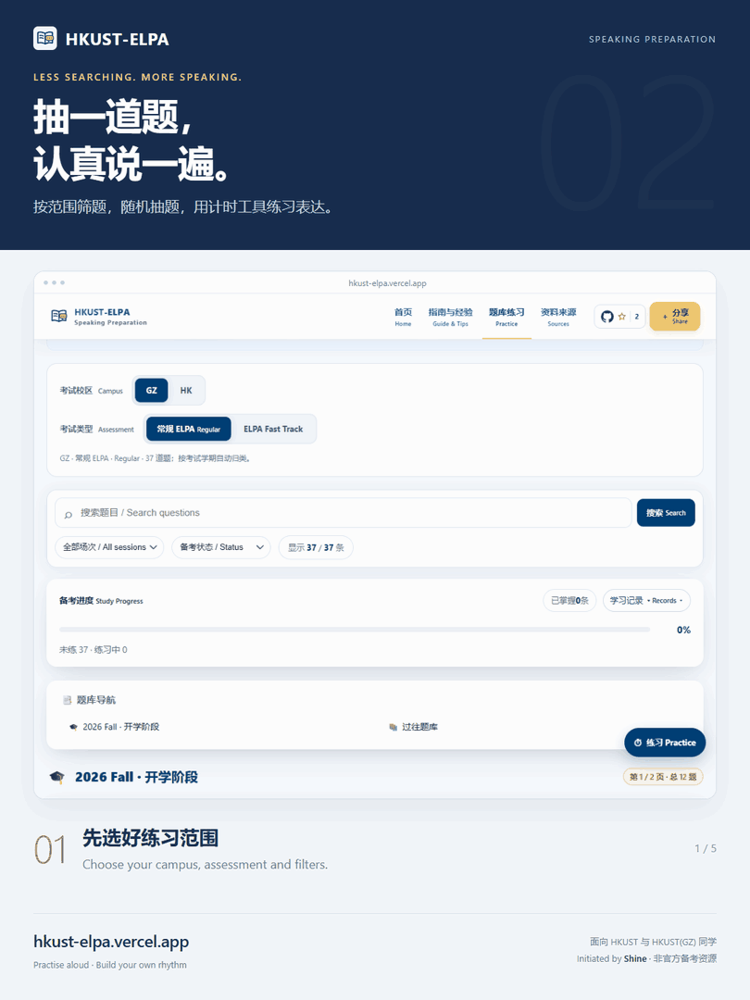
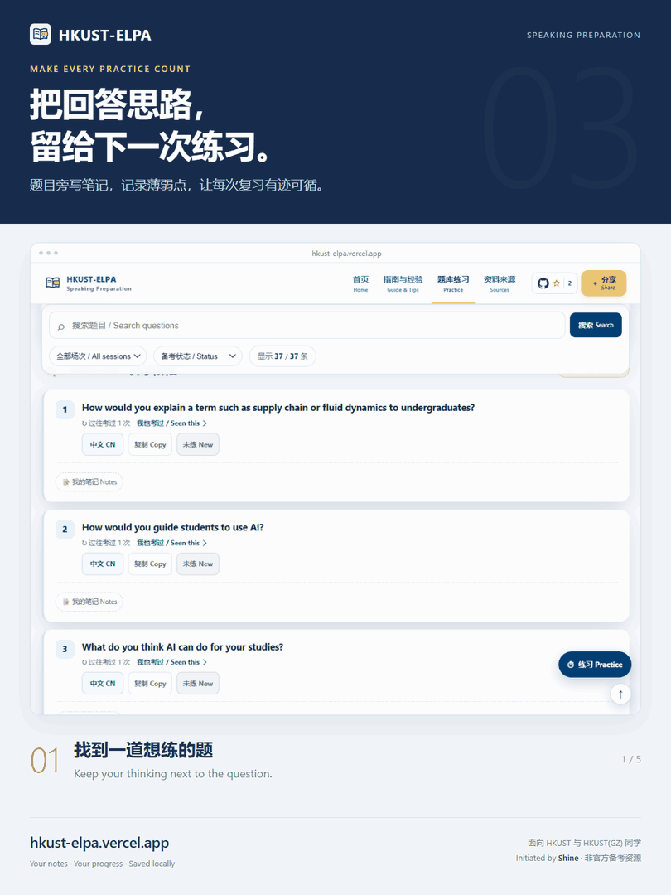
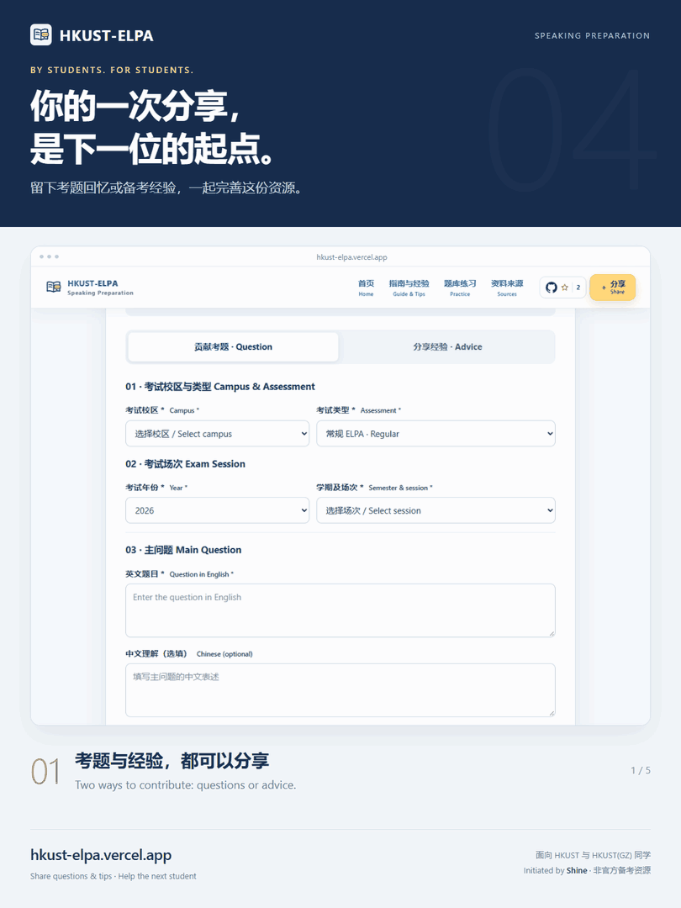

# HKUST-ELPA

**Lightweight ELPA Speaking Preparation · Community-Powered · Serverless by Design**

面向香港科技大学及香港科技大学（广州）同学的**非官方 ELPA 口语备考资源**。查阅考试流程与考生经验，按校区和场次筛选题目，配合随机抽题、计时、笔记和学习记录练习；考后也欢迎留下自己的题目回忆与经验。

An unofficial, student-maintained resource for HKUST and HKUST(GZ). Explore the exam process and student tips, practise English questions, and keep your progress in your browser. Key navigation and controls show Chinese and English together; community contributions retain their original language.

[首页](https://hkust-elpa.vercel.app/) · [指南与经验](https://hkust-elpa.vercel.app/guide.html) · [题库练习](https://hkust-elpa.vercel.app/practice.html) · [分享考题与经验](https://hkust-elpa.vercel.app/submit.html) · [资料来源](https://hkust-elpa.vercel.app/sources.html)

备用入口：[GitHub Pages](https://futseyi.github.io/HKUST-ELPA/)。两个网站使用同一套静态代码，**学习记录不会跨域名自动同步**。

[](https://github.com/FuTseYi/HKUST-ELPA/actions/workflows/site-checks.yml)

## 使用方式

| 页面 | 用途 |
| --- | --- |
| 首页 | 首次使用路线、功能入口及可展开的操作说明。 |
| 指南与经验 | 分别查看常规 ELPA / Fast Track 流程，通过顶部入口阅读或分享考生经验。 |
| 题库练习 | 按 GZ / HK 校区、考试类型、场次、关键词和练习状态筛选。英文题干优先，中文、相似问法及提示小问按需展开。 |
| 社区分享 | 无需注册，可提交回忆题、提示小问、不同问法或备考经验。投稿公开保存，复核后才考虑收录。 |
| 资料来源 | 区分学校说明与学生整理资料，保留参考链接和内容限制。 |

<a href="./promotion/2026-10-17/05-features.png"></a>

*下方可展开练习、笔记与分享的真实页面演示。更多图片及制作源文件见[宣传素材目录](./promotion/README.md)。*

### 练习与复习

1. 先选校区、考试类型和想练的范围。
2. 点击右下角「练习 → 随机抽题」，从当前筛选结果中抽一道。
3. 需要时再点「开始」计时。模拟考试模式提供 **1 分钟准备 + 2 分钟陈述**，也可使用倒计时或正向计时。
4. 练完后标记「未练 / 练习中 / 已掌握」，记录回答思路，下次按状态筛选继续复习。

网站提供抽题和计时工具，**由你自己开口回答，不提供自动对话或 AI 口语评分**。练习计时并非对学校实际考试时长的承诺，现场安排以考官指引为准。

<details>
<summary>查看练习演示 · Practice demo</summary>

选择练习范围 → 随机抽题 → 开始计时 → 查看练习阶段与剩余时间。



</details>

### 保存与迁移记录

- 练习状态与笔记默认自动保存在**当前浏览器、当前网站地址**下，不需要账号。
- 换设备、浏览器或网站地址前，先「备份学习记录」；在新环境中用「恢复学习记录」导入。
- **恢复会替换当前记录，建议先备份。** 清除浏览器数据也可能删除本地记录。
- 支持单独导出笔记；部分浏览器还提供可选的本地文件夹同步。浏览器内自动保存不依赖该功能。

<details>
<summary>查看笔记演示 · Notes demo</summary>

展开笔记 → 记录回答思路 → 标记练习中 → 刷新后笔记仍在。



</details>

### 分享考题与经验

考后可以留下题目回忆、提示小问或备考经验。无需注册，投稿内容公开保存，复核后才考虑收录。

<details>
<summary>查看分享演示 · Share demo</summary>

填写考题或切换至分享经验 → 选择主题并填写 → 预览投稿。演示使用示例内容，未发送真实投稿。



</details>

## 本地预览与验证

### 预览网站

网站无前端框架、无构建步骤。克隆后在根目录启动静态文件服务：

```bash
git clone https://github.com/FuTseYi/HKUST-ELPA.git
cd HKUST-ELPA
python -m http.server 8000
```

macOS / Linux 若没有 `python` 命令，可改用 `python3`。打开 `http://localhost:8000/`。也可直接打开 HTML 文件预览页面；涉及文件读取、下载及浏览器权限的验证应使用本地 HTTP 服务。

本地页面可以练习、保存记录和预览投稿；**正式投稿仅允许已配置的生产站点来源**，本地预览不会获得生产 Turnstile 验证权限。

### 自动化检查

需要 **Node.js 22 或更新版本**。结构、语法与单元测试使用 Node 内置功能，不依赖浏览器安装：

```bash
npm run check
npm test
```

浏览器回归需要安装锁定版本的 Playwright 及其 Chromium：

```bash
npm ci
npx playwright install chromium
npm run test:browser
```

Linux CI 使用 `npx playwright install --with-deps chromium` 安装系统依赖。浏览器测试使用独立测试上下文和本地服务，覆盖 320–1280px 的八种宽度；外部星数、人机验证与投稿请求被隔离，**不会创建公开投稿**。真实 Turnstile、Worker 部署及原生文件夹选择器仍需单独验证。

## 项目结构

```text
HKUST-ELPA/
├── index.html / guide.html / practice.html / sources.html / submit.html
├── site.css                       # 全站共享布局、导航、双语标签与页脚
├── css/                           # 练习页、投稿页专用样式
├── js/                            # 首页、指南、练习和投稿页逻辑
├── github-stars.js                # 可选星数增强：GitHub API → Shields 备用
├── submission-config.js           # 公开投稿端点与 Turnstile Site Key
├── elpa_data.json                 # 空的初始记录文件，非个人备份
├── assets/                        # 图片、图标和功能示意
├── question-bank/                 # 稳定题目、场次、经验及来源文档
├── scripts/                       # 校验、审核数据导入及 PR 文件白名单
├── tests/                         # Worker、导入器、页面逻辑与浏览器回归
├── worker/                        # 独立部署的 Cloudflare 投稿接口
├── docs/                          # 投稿数据约定及维护说明
├── promotion/                     # 按批次归档的宣传成品、截图与制作源文件
├── package.json / package-lock.json # 统一检查命令与锁定的测试依赖
└── .github/workflows/             # 网站校验、批准投稿后生成数据 PR
```

`output/`、`.playwright-cli/`、`node_modules/` 和本地密钥文件均不纳入版本控制。

### 文件维护边界

- **页面与代码分离**：HTML 保留语义内容及真实导航；交互在对应 `js/` 文件中，专用样式在 `css/`。保持经典脚本的加载顺序和现有事件绑定，未经迁移不要改成模块或异步加载。
- **共享导航与页脚**：五个页面保留静态标记，直接打开文件也能导航。修改时同步五页，自动校验会检查导航入口、双语标签和页脚一致性。
- **双语排版**：保留中文主体和简短英文标签；放得下时并排，空间不足时将英文放在下方。题目翻译与用户输入不自动改写。
- **题库与记录兼容**：不重编号已发布题目，不改变既有 localStorage 键。提示小问笔记按位置关联，已发布小问不随意重排；需要调整时必须设计记录迁移。
- **数据与来源分离**：结构化数据负责显示和关联；Markdown 负责来源、场次背景与不确定性，不是自动生成的数据副本。
- **测试与生产分离**：不把测试投稿合并进题库，不将个人学习记录覆盖提交到 `elpa_data.json`，不在测试中调用真实投稿接口。

## 技术架构与内容发布

项目采用**原生静态前端 + Cloudflare Workers 投稿接口 + GitHub 审核协作**。练习、筛选、笔记与计时在浏览器内完成，无需用户账号、业务数据库或常驻应用服务器。

| 组件 | 职责与边界 |
| --- | --- |
| 静态前端 | Vercel / GitHub Pages 托管相同文件，无构建依赖；学习记录按浏览器来源隔离。 |
| GitHub 星数 | 优先读取 GitHub 官方接口，失败时使用 Shields；会话内缓存一小时。两者不可用时隐藏数字，仓库链接仍可用。 |
| 投稿 Worker | 校验来源、Turnstile、频率、大小和字段，成功后只创建待处理的公开 Issue。 |
| 审核工作流 | 仅仓库所有者为开放 Issue 添加 `submission:approved` 时执行，验证数据后生成独立 PR。 |
| 结构化题库 | 常规、Fast Track 和不同校区使用稳定 ID；场次与补充问法独立关联。 |
| 发布 | PR 人工复核、合并后随静态站点部署更新；Worker 不直接发布题目。 |

### 投稿与审核

1. 站内投稿通过 Worker 校验，保存为带 v2 结构化记录的公开 Issue；旧版 v1 待处理记录仍兼容。
2. 维护者核对来源、隐私、重复经历、题干及小问。**考生回忆不等于学校确认的原题。**
3. 仓库所有者添加批准标签，Actions 用受信任的仓库脚本生成数据 PR。
4. PR 只允许修改题库、场次、经验和对应社区文档，不自动合并。

相同题目保留原 ID；新的考试经历增加出现记录，仅补充问法或小问不增加考过次数。授权及完整文件白名单见 [审核说明](./question-bank/MODERATION.md)。

### 安全与外部服务

- 仓库中的 Worker 默认关闭投稿。生产启用、密钥、限流和 Turnstile 配置详见 [Worker 部署文档](./worker/README.md)。
- GitHub / Turnstile 密钥只存放在 Worker Secrets；前端只包含公开端点与 Site Key。
- 请求体上限为 24 KiB；配置的原生限流为每个边缘位置、每 IP 每 60 秒最多 3 次，不等同于全局配额。
- 投稿会公开保存，包括尚未收录的内容。不要填写姓名、学号、联系方式或私人笔记。
- UI 回归、Worker 单元测试和实际生产验证分别提供不同证据；本地测试通过不代表线上部署已更新。

## 维护文档与贡献

| 文档 | 内容 |
| --- | --- |
| [题库说明](./question-bank/README.md) | 数据文件分工、稳定 ID、题目范围与来源规范。 |
| [审核维护说明](./question-bank/MODERATION.md) | v1 / v2 审核、生成 PR、数据文件白名单与发布边界。 |
| [投稿数据规范](./docs/submission-v2-spec.md) | 字段、分类、相似问法、小问及计数规则。 |
| [Worker 文档](./worker/README.md) | 独立部署、开关、密钥和生产验证。 |
| [本次维护审查](./docs/maintenance-review-2026-10-17.md) | 整理范围、已修复问题、验证结果与后续维护边界。 |
| [宣传素材](./promotion/README.md) | 按批次归档宣传图片、GIF、原始截图与制作源文件。 |

考前参考已有经验，考后欢迎通过[站内分享](https://hkust-elpa.vercel.app/submit.html)留下题目与心得。发现资料问题可提交 [Issue](https://github.com/FuTseYi/HKUST-ELPA/issues)，代码和文档改进欢迎提交 [Pull Request](https://github.com/FuTseYi/HKUST-ELPA/pulls)。尊重原作者权益，保留来源，不补造未记录的题干或小问。

## 声明与致谢

HKUST-ELPA 不代表香港科技大学或任何校区的官方立场，也不保证实际考试题目或结果。考试安排和语言要求以学校当期通知为准。

感谢分享考题、经验、笔记与改进建议的同学。资料准确性、署名或权益问题，欢迎通过 GitHub Issues 沟通更正。

**Built with Passion. Shared with Everyone.**

Initiated by [Shine](https://github.com/FuTseYi) · 2026 Fall MPhil
