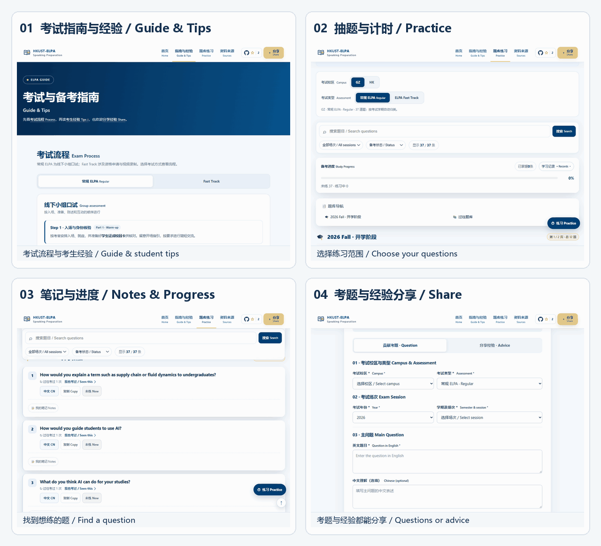

# HKUST-ELPA

**Lightweight ELPA Speaking Preparation · Community-Powered · Serverless by Design**

面向香港科技大学及香港科技大学（广州）同学的非官方 ELPA 口语备考网站。查阅考试流程、筛选题库、随机抽题、计时练习、保存笔记，也欢迎分享考试回忆与备考经验。

[首页](https://hkust-elpa.vercel.app/) · [指南与经验](https://hkust-elpa.vercel.app/guide.html) · [题库练习](https://hkust-elpa.vercel.app/practice.html) · [分享经验](https://hkust-elpa.vercel.app/submit.html) · [资料来源](https://hkust-elpa.vercel.app/sources.html)

[](https://github.com/FuTseYi/HKUST-ELPA/actions/workflows/site-checks.yml)



## 使用指南

| 功能 | 说明 |
| --- | --- |
| 考试指南 | 查看常规 ELPA、Fast Track 流程及学生备考经验。 |
| 题库练习 | 按校区、考试类型、场次、关键词和学习状态筛选；支持随机抽题与计时。 |
| 学习记录 | 标记掌握状态、记录笔记、导出学习记录与跨设备恢复。 |
| 社区投稿 | 分享回忆题目、提示小问或备考经验，审核后收录。 |
| 资料来源 | 查阅官方说明及社区补充资料。 |

学习记录保存在当前浏览器。更换设备或网站地址前，请先使用「备份」，并在新环境中使用「恢复」；恢复会覆盖现有记录。

网站由学生维护，不代表学校官方立场；考试安排与要求以学校当期通知为准。

## 本地开发

网站使用原生 HTML、CSS、JavaScript 和 Python 构建，生成的静态文件位于 `_site/`。

```sh
# Windows
py -3 preview.py

# macOS / Linux
python3 preview.py
```

在 `http://127.0.0.1:8765/` 预览。修改源码后自动构建，刷新浏览器即可。仅构建使用 `py -3 preview.py --build-only`（macOS / Linux 使用 `python3`）。

### 检查

```sh
node scripts/validate-site.cjs
node --test
python -m unittest discover -s tests -t . -p "test_*.py"
```

浏览器回归使用 Python Playwright：

```sh
python -m pip install -r requirements-dev.txt
python -m playwright install chromium webkit
python tests/browser_smoke.py
```

## 项目结构

```text
HKUST-ELPA/
├── index.html          # 首页、指南与资料来源
├── practice.html       # 题库练习
├── submit.html         # 社区投稿
├── preview.py          # 构建与本地预览
├── assets/             # 样式、脚本与媒体
├── data/               # 投稿配置与空白记录模板
├── question-bank/      # 题库、场次、经验与出处
├── scripts/            # 静态构建、验证与自动入库
├── tests/              # 单元与浏览器测试
├── worker/             # Cloudflare 投稿接口
├── requirements-dev.txt
└── .github/workflows/ # CI、部署和投稿审核
```

`index.html` 是公共导航、页脚以及指南和资料来源内容的统一维护入口。Python 构建输出首页、指南、练习、资料来源、投稿五个静态页面。

## 技术与维护

网站通过 Vercel 和 GitHub Pages 发布 `_site/`，无需前端框架或应用服务器。题库以 JSON 为权威来源，由 Python 构建浏览器资源。用户学习记录仅保存在本地。

投稿由 Cloudflare Worker 校验并创建 GitHub Issue。仓库所有者审核后，使用 **Close as completed** 触发自动入库；`submission:published` 表示数据已写入 `main`，上线状态以部署结果为准。

相关文档：[题库说明](./question-bank/README.md) · [投稿审核](./question-bank/MODERATION.md) · [Worker 部署](./worker/README.md)

欢迎通过 [Issues](https://github.com/FuTseYi/HKUST-ELPA/issues) 反馈资料问题，或通过 [Pull Requests](https://github.com/FuTseYi/HKUST-ELPA/pulls) 参与共建。投稿请勿包含姓名、学号或联系方式等个人信息。

**Built with Passion. Shared with Everyone.**

Initiated by [FuTseYi](https://github.com/FuTseYi) · Infrastructure sponsored by the initiator.
