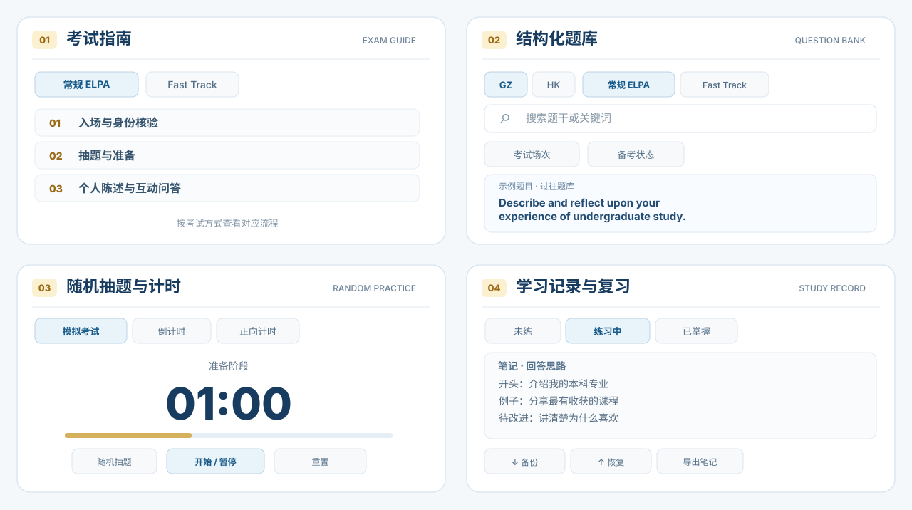
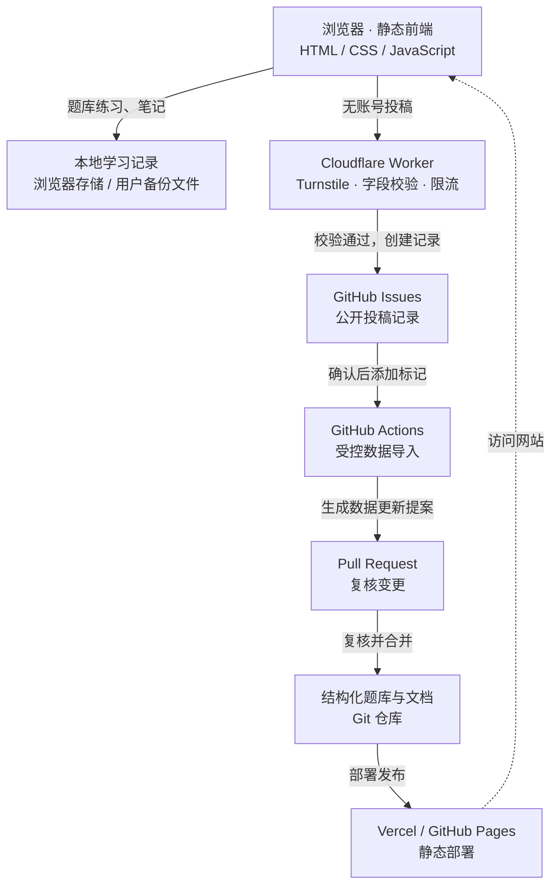

# HKUST-ELPA

**Lightweight ELPA Speaking Preparation · Community-Powered · Serverless by Design**

一个面向香港科技大学（HKUST）及香港科技大学（广州）（HKUST(GZ)）学生的**轻量化、可持续维护的非官方 ELPA 口语备考项目**。

整合考试指南、考生分享题库、随机抽题与计时工具、个人学习记录和社区分享。**打开网页即可练习，无需注册账号；学习进度与笔记默认保存在当前浏览器。**

[**在线体验 · Vercel**](https://hkust-elpa.vercel.app/) · [**备用入口 · GitHub Pages**](https://futseyi.github.io/HKUST-ELPA/) · [**考试指南**](https://hkust-elpa.vercel.app/guide.html) · [**题库练习**](https://hkust-elpa.vercel.app/practice.html)

[](https://github.com/FuTseYi/HKUST-ELPA/actions/workflows/site-checks.yml)

**快速导航：**[功能概览](#功能概览) · [使用指南](#使用指南) · [技术架构](#技术架构与工程实现) · [参与贡献](#题库维护与贡献)

## 功能概览

| 功能 | 可以做什么 |
| --- | --- |
| **考试指南与题库** | 了解常规 ELPA / Fast Track 的流程；按校区、考试类型、场次和关键词查找题目，按需展开翻译与提示小问。 |
| **随机抽题与自主练习** | 从当前筛选结果中随机抽一道题，配合准备计时、陈述计时、倒计时或正向计时，自己开口练习。 |
| **学习记录与复习** | 给题目标记「未练 / 练习中 / 已掌握」，记录回答思路；下次筛选没练熟的题目继续复习，支持备份与恢复。 |
| **社区分享与资料来源** | 无需账号分享考题和备考经验；分别查阅学校官方说明与学生整理的资料。 |



*以上为依据网站首页功能界面整理的静态示意，实际操作以在线网站为准。*

> **关于口语练习：**网站提供随机抽题和计时工具，由使用者自行回答；不提供自动对话或 AI 口语评分。

## 使用指南

### 01 · 考试指南与结构化题库

- **考试方式切换**：区分常规 ELPA 与 ELPA Fast Track，提供对应流程与学习入口。
- **多维查找**：支持校区（GZ / HK）、考试类型、场次、关键词和备考状态筛选；实际题目覆盖范围以已收录内容为准。
- **英语练习优先**：题目主问题以英文展示，中文释义、相似问法与提示小问按需查看。
- **分期整理与溯源**：根据已收录场次区分近期与过往题目；保留考生回忆、不同问法和来源限制，不将回忆题称作官方真题。

### 02 · 随机抽题与自主计时

1. 在[题库练习页](https://hkust-elpa.vercel.app/practice.html)选择本次想练的范围。
2. 点击页面右下角的**「练习」→「随机抽题」**，从当前符合条件的题目中抽取一道。
3. 点击**「开始」**后自己进行口语练习。模拟考试计时先进行 **1 分钟准备**，随后进入 **2 分钟陈述**；另支持倒计时、正向计时和暂停、重置。

随机抽题与启动计时是独立操作，不会自动代答或评分。

### 03 · 个人学习记录：练习、标记、复盘

- 每道题可在 **未练 → 练习中 → 已掌握** 之间切换，优先筛选尚未掌握的问题。
- 可对主问题及提示小问添加自己的回答思路与笔记，支持格式化编辑和预览。
- 学习进度与笔记**默认自动保存在当前浏览器**，无需登录；可通过**备份学习记录 → 传输文件 → 在新设备恢复**迁移，也可单独导出笔记。
- 支持部分浏览器可选关联文件夹，用于写入本地数据文件；不启用该功能也不影响浏览器内的自动保存。

> **重要：**不同浏览器、设备以及 Vercel / GitHub Pages 域名不会自动同步记录。清除浏览器数据前请先备份；恢复会替换当前浏览器已有的记录。

### 04 · 开放的社区分享

无需注册账号即可通过 [社区分享页面](https://hkust-elpa.vercel.app/submit.html)提供新考题、补充相似问法或提示小问，也可以分享备考经验。投稿会以**公开 GitHub Issue** 保存，必要时整理后收录；请不要提交姓名、学号、联系方式、私人笔记或其他敏感信息。

---

## 技术架构与工程实现

项目采用**原生静态前端 + Serverless 投稿接口 + GitHub 原生协作流程**。日常练习不依赖应用后端请求，社区内容通过独立接口接收、校验和版本化发布；无需自建用户账号系统、业务数据库或常驻应用服务器。

### 技术设计特点

| 设计维度 | 实现方式 |
| --- | --- |
| **静态优先** | 使用原生 HTML、CSS 与 JavaScript，无前端框架和打包流程，可直接部署到 Vercel 或 GitHub Pages。 |
| **本地数据与隐私** | 学习记录保存在浏览器或用户主动保存的备份文件中，无需为个人练习建立服务端账号和数据库。 |
| **无服务器投稿接口** | Cloudflare Workers 提供独立投稿入口，配合 Turnstile、来源限制、字段校验、限流与默认关闭机制。 |
| **可追溯的内容发布** | GitHub Issues 保存公开投稿记录，GitHub Actions 在授权确认后生成数据变更 PR，由人工复核、合并并触发网站更新。 |
| **可维护的数据模型** | 题目、相似问法、考试场次及经验独立保存为结构化数据，使用稳定 ID 并保留资料来源。 |

### 系统架构：静态前端与事件驱动内容发布



该架构将**客户端学习状态**与**服务端投稿流程**分离，各组件职责如下：

- **日常练习**直接由静态页面在浏览器内完成，不需要为每次搜索、翻译展开、计时或保存笔记调用应用后端。
- **社区投稿**才调用 Cloudflare Worker；Worker **只创建待处理的 GitHub Issue**，不会直接修改已发布题库。
- **内容更新**由受控的 GitHub Actions 脚本处理，生成独立 PR；未经复核和合并，不会进入网站正式数据。
- **内容与部署同源**：两个网站入口使用同一仓库代码；个人学习记录仍各自保存在对应浏览器和域名下。

### 服务端安全与内容发布机制

投稿接口由 [`worker/src/index.js`](./worker/src/index.js) 实现，负责接收、校验并转交投稿。后续处理由 [GitHub Actions 工作流](./.github/workflows/approved-submission.yml)及[受控导入脚本](./scripts/import-v2-submission.cjs)完成。**接口不直接修改已发布题库；数据变更须经独立 Pull Request 复核后合并。**

| 控制环节 | 实现机制与约束 |
| --- | --- |
| 请求接收与数据校验 | Cloudflare Workers 接收题目、相似问法、提示小问及备考经验等结构化投稿，校验字段类型、长度及允许值。 |
| 来源限制与人机验证 | 接口仅处理来自预设生产域名的浏览器请求；服务端调用 Cloudflare Turnstile Siteverify，并核对验证结果中的域名及动作。 |
| 请求大小与频率限制 | 请求体上限为 **24 KiB**；Cloudflare 原生限流配置为每个边缘位置、每个 IP **60 秒最多 3 次**。该限制按边缘位置执行，不等同于全局配额。 |
| 配置与故障保护 | 仓库中的 Worker 配置默认关闭投稿；生产环境需显式启用。凭据缺失、限流服务异常或人机验证不可用时，接口拒绝请求（fail closed）。 |
| 凭据与最小权限 | 敏感凭据存放于 Cloudflare Worker Secrets，不下发到浏览器；部署文档规定 GitHub 令牌仅授予指定仓库的 Issues 读写权限。 |
| 审核与版本化发布 | 验证通过的投稿保存为公开 GitHub Issue；经授权维护者确认后，由 GitHub Actions 再次校验并生成数据变更 PR。**PR 不自动合并，正式发布仍需人工复核。** |

**架构边界：**该方案以 GitHub Issues、Pull Requests 和 Git 历史承担内容协作与变更追踪，不依赖自建用户系统、业务数据库或独立管理后台。安全控制面向当前项目规模设计；例如，边缘限流并非全局防滥用保证，人工复核也仍是内容发布流程的一部分。

更详细的接口、开关和安全配置见 [Worker 文档](./worker/README.md)与 [投稿数据规范](./docs/submission-v2-spec.md)。

## 技术栈与项目结构

| 层次 | 技术与职责 |
| --- | --- |
| 前端 | Vanilla HTML、CSS、JavaScript；静态多页面网站，零前端框架和构建步骤 |
| 个人记录 | 浏览器本地存储；JSON 备份 / 恢复；可选 File System Access API 文件夹同步 |
| 投稿接口 | Cloudflare Workers、Turnstile、Cloudflare Rate Limiting |
| 内容协作 | GitHub Issues、GitHub Actions、Pull Requests、结构化 JavaScript 数据文件 |
| 部署 | Vercel + GitHub Pages |
| 质量检查 | Node.js 测试、语法及数据校验、Playwright / Chromium 响应式浏览器回归 |

```text
HKUST-ELPA/
├── index.html                     # 首页 / 功能介绍
├── guide.html                     # 考试指南
├── practice.html                  # 题库、随机抽题、计时与笔记
├── sources.html                   # 学校说明与学生资料来源
├── submit.html                    # 无账号社区分享
├── site.css                       # 共享样式
├── question-bank/                 # 结构化题目、场次、备考经验与来源文档
├── worker/
│   ├── src/index.js               # Serverless 投稿接口
│   └── README.md                  # 部署与安全说明
├── scripts/                       # 受控投稿导入脚本
├── .github/workflows/
│   ├── approved-submission.yml    # 已确认投稿 → 数据更新 PR
│   └── site-checks.yml            # 代码与浏览器回归校验
├── tests/                          # 导入器、Worker、网页交互与移动端测试
└── docs/submission-v2-spec.md     # 社区投稿数据约定
```

### 本地预览与测试

无需安装前端框架或运行应用服务器；在仓库根目录启动任意静态文件服务即可预览：

```bash
git clone https://github.com/FuTseYi/HKUST-ELPA.git
cd HKUST-ELPA
python3 -m http.server 8000
```

然后打开 `http://localhost:8000/`。本地预览可使用题库与记录功能；**正式投稿接口仅允许已配置的生产站点来源**，因此本地页面无法直接向线上 Worker 投稿。

核心自动化测试使用 Node.js；浏览器回归测试由 CI 安装 Playwright 并通过 Chromium 执行，见 [网站检查工作流](./.github/workflows/site-checks.yml)。

## 题库维护与贡献

题库并非散落在 HTML 中的硬编码列表：结构化题目、场次记录和备考经验分别保存在 [`question-bank/`](./question-bank/README.md) 中，维护稳定 ID，降低更新题库时影响已有学习记录的风险。

- **反馈内容**：通过[站内分享](https://hkust-elpa.vercel.app/submit.html)补充考题与经验，或在 [Issues](https://github.com/FuTseYi/HKUST-ELPA/issues) 提出更正建议。
- **改进项目**：欢迎通过 [Pull Requests](https://github.com/FuTseYi/HKUST-ELPA/pulls) 贡献页面改进、文档修订和测试。
- **尊重来源**：保持原题、回忆、翻译与整理表述之间的区别；保留可信范围和原始链接，不凭空补全不确定的内容。

项目追求**可阅读、可验证、可回滚、可长期维护**。具体来源见[资料来源页](https://hkust-elpa.vercel.app/sources.html)，技术细节见 [Worker 文档](./worker/README.md)。

## 声明与致谢

HKUST-ELPA 是学生发起、开放协作的**非官方备考资源**，不代表香港科技大学或任何校区的官方立场。考试安排和语言要求应以学校当期通知为准；考生分享的题目不等于学校确认的真实题卡，也不能保证考试通过。

感谢分享考题、经验、笔记与改进建议的同学。对于来源标注、原作者权益或内容准确性问题，欢迎通过 GitHub Issues 沟通更正。

**Built with Passion. Shared with Everyone.**
